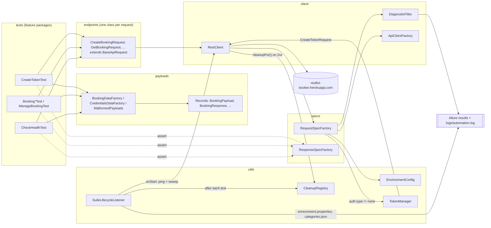

# Architecture Blueprint: restful-booker API Test Framework

Target API: `https://restful-booker.herokuapp.com` ([apiDoc](https://restful-booker.herokuapp.com/apidoc/index.html), data source `apidoc/api_data.json`).
Designed and probed on **2026-11-17**. Companion document: [TEST_CASES_MATRIX.md](TEST_CASES_MATRIX.md).

---

## 1. Standards

The architecture, patterns, naming, folder layout, logging, reporting, cleanup and execution rules come from [docs/STANDARDS.md](docs/STANDARDS.md), cited here as `Rule x.y` / `§x.y`. [docs/RULES_DIGEST.md](docs/RULES_DIGEST.md) is the short version the builder reads in full. This blueprint only adds what the Standards do not cover: project decisions, target-API overrides (§2) and project-specific contracts (§6). Where a class follows a Standards sample unchanged, it says "as Standards §x.y". Where §2 and the Standards conflict, §2 wins.

---

## 2. Overrides

| ID | Standards rule | Change | Reason |
|---|---|---|---|
| O1 | §4 (Logback example) | Log4j2 is the SLF4J backend: `log4j-slf4j2-impl` + `log4j-core`, configured in `src/test/resources/log4j2-test.xml`. It has a Console appender and a RollingFile appender (`logs/automation.log`, roll at 10 MB, keep 5). The pattern is `%d{HH:mm:ss.SSS} %-5level [%thread] [%X{test}] %logger{0} - %msg%n`. Code logs through SLF4J only (Rule 4.10). | Project decision |
| O2 | §2.4 | DTOs are Java `record`s. Lombok `@Builder` is used on `BookingPayload` and `PartialBookingPayload`, which the factories and negative payloads need. Lombok has `test` scope and is listed in `maven-compiler-plugin` `annotationProcessorPaths`, with `<proc>full</proc>`. JDK 23+ disables implicit annotation processing. | Project decision |
| O3 | Rule 3.9, 3.24 | Test data uses Datafaker (`net.datafaker`, one `Faker` per thread through a `ThreadLocal`, because `Faker` is not thread-safe) plus an 8-char UUID suffix. **Marker:** `lastname = "QA-AUTO"`. `GET /booking?lastname=QA-AUTO` is exact-match and searchable, as verified. Uniqueness comes from `firstname = <Datafaker first name>-<uuid8>`. The pre-suite sweep in `SuiteLifecycleListener` searches for the marker and deletes the matches. | Project decision |
| O4 | §3.5 (Bearer + `expires_in`) | Auth is configurable through `auth.type` = `none` (default) \| `cookie-token` \| `bearer`. This project uses **`cookie-token`**. With `none`, `RequestSpecFactory.authenticated()` returns `anonymous()` and `TokenManager` is never called. With `cookie-token`, the token is cached for the whole run (no expiry info) and sent as cookie `token=<value>`. With `bearer`, behavior is as Standards §3.5. Rules 3.13–3.16 apply whenever auth is not `none`. | Restful-booker auth is `Cookie: token=` or Basic auth (verified: both return 200 on PUT) |
| O5 | Rule 2.6, 2.12 | Negative-test hooks stay inside request classes: (a) `UpdateBookingRequest`, `PartialUpdateBookingRequest` and `DeleteBookingRequest` expose `withToken(String)`; (b) `CreateBookingRequest.withRawBody(String)` takes constants from `payloads/factories/MalformedPayloads`; (c) wrong-type bodies use a typed DTO, `TextPriceBookingPayload`, not raw strings. | Tests never set headers or build JSON |
| O6 | Rule 2.15 | Negative scope is **one representative test per category**: missing required field (`POST /booking`), wrong data type (`POST /booking`), malformed JSON (`POST /booking`), non-existent ID (`DELETE /booking/{id}`) and invalid token (`PUT /booking/{id}`). Other permutations of these categories were observed (see §9), but they are not automated. | Wrong-level testing is avoided |
| O7 | Rule 4.7 | **Dual-test rule:** each O6 representative that deviates gets an *actual-behavior* test (`regression`, CI gate) and a *contract-expectation* test (`known-defect`, `@Issue("RB-DEF-xxx")`, assertion messages prefixed `[KNOWN-DEFECT]`). Deviations outside O6 get the actual-behavior test only. `categories.json` lists **"Known defects"** first. | Gate stays green on known API bugs, and they stay visible |
| O8 | Rule 3.2, §6.2 | Only `config/dev.properties` exists. The suites are `smoke.xml`, `regression.xml` (excludes `known-defect` and `quarantine`) and `known-defects.xml` (non-blocking). | A single public environment |
| O9 | Rule 1.8 | All versions are the latest stable releases on Maven Central, **verified on 2026-11-17** (§5). Samples adapted because of newer major versions: **REST Assured 6.x** (`ApiClientFactory` timeouts, O13) and **Allure Java 3.x** (result-directory cleanup is left to the build tool, so CI runs `mvn clean` once before the first suite; report generation is covered by O17). | Standards samples target REST Assured 5 and Allure 2 |
| O10 | Rule 2.18, 2.19 | N/A: public demo API. No architecture diagrams exist, and auth is internal (no external IdP). | — |
| O11 | Stack line, §1 (`maven.compiler.release` 17) | **Java 25 (LTS):** `maven.compiler.release` = 25 and CI uses Temurin 25. JDK 25 support was checked for every dependency (§5). | Project decision |
| O12 | Rule 3.19, `CleanupRegistry` §3.6 | `BaseApiRequest` gets `public boolean isAlreadyGone(int statusCode)` (default: `statusCode == 404`). `DeleteBookingRequest` overrides it to return `true` for **404 or 405**. `CleanupRegistry.deleted()` uses `deleteRequest.isAlreadyGone(status)` in place of the hard-coded 404. | Restful-booker returns **405** when deleting an ID that is already gone (verified). Without this, every test that deletes its own booking would report a false leak |
| O13 | §2.2 `ApiClientFactory` | Use `HttpClientConfig.httpClientConfig().connectTimeout(Duration.ofSeconds(10)).readTimeout(Duration.ofSeconds(30))` in place of `setParam("http.connection.timeout"…)` / `setParam("http.socket.timeout"…)`. | REST Assured 6.x added the `Duration` API and deprecated the HttpClient 4 params, which are removed in 7.0 (changelog 6.x). 10 s connect allows for Heroku dyno cold starts |
| O14 | §4 `DiagnosticFilter` | (a) Also print `request.getCookies()` with masked values: the token is sent through the cookie API, so it is not a header. (b) For responses ≥ 400, attach a masked cURL command to Allure (`"cURL"`) and log it at DEBUG (Rule 4.11). | Rule 4.1 diagnosability; Rule 4.3 masking |
| O15 | Rule 3.5 | `EnvironmentConfig.get(String key, String defaultValue)` is added **only** for the optional keys `auth.type` (default `none`, per O4) and `sweep.enabled` (default `true`). Every other key still fails fast through `get(key)`. | O4 mandates a default |
| O16 | §6.1 `SuiteLifecycleListener` | `onStart`: health check (`CheckHealthRequest.sendAsSetup(201)`), then the marker sweep (O3). `onFinish`: **append** still-leaked resources to `target/leaked-resources.txt`, and write `leaked.resources` as the total line count of that file, because two suite invocations share one results dir in CI. `environment.properties` also gets `auth.type` and `java.version`. | Fail fast when the env is down; leaked count stays correct across both CI suites |
| O17 | §4 reporting toolchain | Results come from `allure-testng` 3.1.1. The HTML report is generated with **Allure 2 commandline 2.46.2** through `allure-maven` `<reportVersion>2.46.2</reportVersion>`. (allure-maven 3.x defaults to the Allure 3 Node-based report.) | Rules 4.7/4.9 rely on `categories.json` and `environment.properties`, which the Allure 2 report reads natively. Allure 3 configures these differently, so it is not adopted |
| O18 | §1 tree / dependencies | **Not used:** `DatabaseUtils` (no DB access to a public API), Awaitility (the API is synchronous, so there is nothing to poll; Rule 3.6 still forbids `Thread.sleep`), WireMock (no downstream dependencies to virtualize, Appendix B). | Not applicable |
| O19 | Rule 6.8 / §6.2 sample | `TransientRetryAnalyzer` is attached to **every** `@Test` and checks the whole cause chain for `SocketTimeoutException` / `ConnectException` (REST Assured may wrap them). Max 1 retry is unchanged. | Shared public Heroku host |
| O20 | Rule 1.4 | `BookingDates` (a nested record shared by payload and response DTOs) has no `Payload`/`Response` suffix and carries both `@JsonInclude(NON_NULL)` and `@JsonIgnoreProperties(ignoreUnknown = true)`. | A single shared type avoids duplicated DTOs (Rule 2.5 composition) |
| O21 | Rule 2.10 | `Accept: application/json` is sent explicitly, as in the Standards. Note: the probe showed JSON even without `Accept`, but the docs require it. | Quirk list says "must send"; harmless |
| O22 | §4.7 categories | Known-defect contract tests use TestNG `Assert.assertEquals(actual, expected, "[KNOWN-DEFECT] RB-DEF-xxx: …")` (hard assert), not `ResponseSpecFactory`. REST Assured's own messages cannot carry the prefix that `categories.json` matches. | O7 regex must match |
| O23 | Rule 3.14 | Tests whose **system under test is `POST /auth` itself** (`CreateTokenTest`: TC-AUTH-001, TC-NEG-001, TC-SCH-001, TC-SCH-002; and `ManageBookingTest#issuedToken_authorizesUpdate`, TC-E2E-003) send `CreateTokenRequest` directly. No other test logs in: every other authenticated call gets its token from `TokenManager`. | Rule 3.14 targets logins used as setup; here the login *is* the behavior being tested |
| O24 | §4 `categories.json` sample | (a) "Known defects" is the first entry and matches `failed` **and** `broken` (O7). (b) The "Automation infrastructure failures" regex adds `UnknownHost` to the Standards list: `.*(timed out\|Connection refused\|Login failed\|ConditionTimeout\|UnknownHost).*`. | (a) a known defect can surface as an exception, not only an assertion; (b) DNS failures on the CI runner are infrastructure, not product defects |

---

## 3. Project parameters

| Parameter | Value |
|---|---|
| groupId | `io.github.alhusseinzaghloul` |
| artifactId | `restful-booker-api-framework` |
| version | `1.0.0-SNAPSHOT` |
| Base package | `io.github.alhusseinzaghloul.restfulbooker` |
| Java | 25 (`maven.compiler.release=25`) |
| Encoding | UTF-8 |

`src/test/resources/config/dev.properties`:

| Key | Default | Notes |
|---|---|---|
| `base.uri` | `https://restful-booker.herokuapp.com` | |
| `base.path` | *(empty)* | Key present with an empty value, so `get()` returns `""` |
| `auth.type` | `cookie-token` | Read with `get("auth.type", "none")` (O15) |
| `auth.path` | `/auth` | |
| `auth.username` | `admin` | |
| `auth.password` | — | **Not in the file.** Comes from env var `AUTH_PASSWORD` (Rule 3.4). CI secret `AUTH_PASSWORD`. Local: `export AUTH_PASSWORD=...` (the public demo value is published in the API docs) |
| `sweep.enabled` | `true` | Read with `get("sweep.enabled", "true")` (O15) |

Selection: `-Denv=dev` (default `dev`, Standards §3.1). Run: `mvn clean test -Dsuite=src/test/resources/suites/smoke.xml`.

---

## 4. Directory & package tree

```text
restful-booker-api-framework/
├── pom.xml
├── ARCHITECTURE_BLUEPRINT.md
├── TEST_CASES_MATRIX.md
├── README.md                                   (how to run; points to docs/)
├── .gitignore                                  (target/, logs/, .idea/, *.iml)
├── .github/workflows/api-tests.yml
├── docs/
│   ├── STANDARDS.md
│   └── RULES_DIGEST.md
└── src/test/
    ├── java/io/github/alhusseinzaghloul/restfulbooker/
    │   ├── tests/
    │   │   ├── auth/
    │   │   │   └── CreateTokenTest.java
    │   │   ├── booking/
    │   │   │   ├── CreateBookingTest.java
    │   │   │   ├── GetBookingTest.java
    │   │   │   ├── GetBookingIdsTest.java
    │   │   │   ├── UpdateBookingTest.java
    │   │   │   ├── PartialUpdateBookingTest.java
    │   │   │   ├── DeleteBookingTest.java
    │   │   │   └── ManageBookingTest.java          (end-to-end flows)
    │   │   └── health/
    │   │       └── CheckHealthTest.java
    │   ├── endpoints/
    │   │   ├── auth/
    │   │   │   └── CreateTokenRequest.java
    │   │   ├── booking/
    │   │   │   ├── CreateBookingRequest.java
    │   │   │   ├── GetBookingRequest.java
    │   │   │   ├── GetBookingIdsRequest.java
    │   │   │   ├── UpdateBookingRequest.java
    │   │   │   ├── PartialUpdateBookingRequest.java
    │   │   │   └── DeleteBookingRequest.java
    │   │   └── health/
    │   │       └── CheckHealthRequest.java
    │   ├── payloads/
    │   │   ├── pojos/
    │   │   │   ├── CredentialsPayload.java
    │   │   │   ├── TokenResponse.java
    │   │   │   ├── BookingPayload.java
    │   │   │   ├── PartialBookingPayload.java
    │   │   │   ├── TextPriceBookingPayload.java
    │   │   │   ├── BookingDates.java
    │   │   │   ├── BookingResponse.java
    │   │   │   ├── CreatedBookingResponse.java
    │   │   │   └── BookingIdResponse.java
    │   │   └── factories/
    │   │       ├── BookingDataFactory.java
    │   │       ├── CredentialsDataFactory.java
    │   │       └── MalformedPayloads.java
    │   ├── client/
    │   │   ├── BaseApiRequest.java
    │   │   ├── RestClient.java
    │   │   ├── ApiClientFactory.java
    │   │   └── DiagnosticFilter.java
    │   ├── specs/
    │   │   ├── RequestSpecFactory.java
    │   │   └── ResponseSpecFactory.java
    │   └── utils/
    │       ├── EnvironmentConfig.java
    │       ├── TokenManager.java
    │       ├── CleanupRegistry.java
    │       ├── SetupFailedException.java
    │       ├── SuiteLifecycleListener.java
    │       └── TransientRetryAnalyzer.java
    └── resources/
        ├── config/dev.properties
        ├── schemas/
        │   ├── token.schema.json
        │   ├── auth-failure.schema.json
        │   ├── created-booking.schema.json
        │   ├── booking.schema.json
        │   └── booking-ids.schema.json
        ├── suites/
        │   ├── smoke.xml
        │   ├── regression.xml
        │   └── known-defects.xml
        ├── META-INF/services/org.testng.ITestNGListener
        ├── allure.properties
        ├── categories.json
        └── log4j2-test.xml
```

Packages follow Rule 1.2 (six top-level packages) and Rule 1.1 (feature folders: `auth`, `booking`, `health`). Everything lives in `src/test/java` with `test` scope (Rule 1.5).

---

## 5. Dependency matrix

Verified on Maven Central (`repo1.maven.org/maven2/.../maven-metadata.xml`, stable versions only) on **2026-11-17**. All dependencies use `test` scope (Rule 1.5).

| groupId | artifactId | Version | Scope | JDK 25 compatible | Notes |
|---|---|---|---|---|---|
| `io.rest-assured` | `rest-assured` | 6.3.0 | test | Yes. Baseline `release 17`; Groovy 5.0.8 (transitive via json-path) supports JDK 25 | 7.0.0-RC1 exists and is excluded (not stable) |
| `io.rest-assured` | `json-schema-validator` | 6.3.0 | test | Yes (pure Java) | `matchesJsonSchemaInClasspath` |
| `com.fasterxml.jackson.core` | `jackson-databind` | 2.23.0 | test | Yes | Optional in REST Assured, so it must be declared. Jackson 2 is kept (same coordinates and annotations as the Standards); Jackson 3 (`tools.jackson`) is not used |
| `org.testng` | `testng` | 7.12.0 | test | Yes (baseline 11) | |
| `io.qameta.allure` | `allure-bom` | 3.1.1 | import (dependencyManagement) | Yes (Allure Java 3 baseline 17) | |
| `io.qameta.allure` | `allure-testng` | (BOM) 3.1.1 | test | Yes | `Allure.step(...)` lambdas, so no AspectJ agent is needed (Standards §1 note) |
| `org.slf4j` | `slf4j-api` | 2.0.20 | test | Yes | |
| `org.apache.logging.log4j` | `log4j-slf4j2-impl` | 2.26.1 | test | Yes | O1 |
| `org.apache.logging.log4j` | `log4j-core` | 2.26.1 | test | Yes | O1 |
| `org.projectlombok` | `lombok` | 1.18.48 | test (also in `annotationProcessorPaths`) | Yes. Lombok changelog: JDK 25 support since 1.18.40/1.18.42 | O2 |
| `net.datafaker` | `datafaker` | 2.7.0 | test | Yes (baseline 17) | O3 |

**Plugins**

| groupId | artifactId | Version | JDK 25 | Configuration |
|---|---|---|---|---|
| `org.apache.maven.plugins` | `maven-compiler-plugin` | 3.16.0 | Yes (prereq Maven 3.6.3) | `<release>25</release>`, `<proc>full</proc>`, `annotationProcessorPaths` → `lombok:${lombok.version}` |
| `org.apache.maven.plugins` | `maven-surefire-plugin` | 3.6.1 | Yes | `<suiteXmlFiles><suiteXmlFile>${suite}</suiteXmlFile></suiteXmlFiles>`; property `suite` defaults to `src/test/resources/suites/regression.xml`; `<systemPropertyVariables><allure.results.directory>${project.build.directory}/allure-results</allure.results.directory></systemPropertyVariables>` |
| `io.qameta.allure` | `allure-maven` | 3.1.0 | Yes | `<reportVersion>2.46.2</reportVersion>` (O17), `<resultsDirectory>allure-results</resultsDirectory>`, `<reportDirectory>${project.build.directory}/allure-report</reportDirectory>` |
| `io.qameta.allure` | `allure-commandline` | 2.46.2 | Yes (runs on any JDK ≥ 8) | Downloaded by `allure-maven`; not a project dependency |

Local toolchain seen on the dev machine: Temurin 25.0.5, Maven 3.9.9 (both are fine).

---

## 6. Class contracts

Unless a contract says otherwise, every class follows the Standards sample named next to it. All classes are `final` except `SetupFailedException` and the listener and retry classes (Standards).

### 6.1 `client`

**`BaseApiRequest`**: as Standards §2.1, plus:
```java
private String tokenOverride;                                  // null = use the default auth
protected final void tokenOverride(String token)  { this.tokenOverride = token; }
String tokenOverride()                            { return tokenOverride; }   // package-private, for RestClient
/** O12. A cleanup DELETE that returns this status means the resource is already gone. */
public boolean isAlreadyGone(int statusCode)      { return statusCode == 404; }
```

**`RestClient`**: as Standards §2.2. Spec selection delta:
```java
RequestSpecification base = request.tokenOverride() != null
        ? RequestSpecFactory.withToken(request.tokenOverride())
        : request.requiresAuth() ? RequestSpecFactory.authenticated() : RequestSpecFactory.anonymous();
```

**`ApiClientFactory`**: as Standards §2.2 with O13: `public static RestAssuredConfig config()` returns `RestAssuredConfig.config().httpClient(HttpClientConfig.httpClientConfig().connectTimeout(Duration.ofSeconds(10)).readTimeout(Duration.ofSeconds(30)))`.

**`DiagnosticFilter`**: as Standards §4, plus O14:
- `describe(request)` appends `Cookie: <name>=***` for each `request.getCookies()` entry.
- When `response.statusCode() >= 400`: build a cURL (`curl -X <M> '<URI>' -H '<h>: <v>' ... --data '<masked body>'`, with masked headers, cookies and secret fields) → `Allure.addAttachment("cURL", "text/plain", curl)` and `LOG.debug("cURL: {}", curl)`.
- `MASKED_HEADERS` and `SECRET_FIELDS` as Standards. `SECRET_FIELDS` already covers `"token"` (the `/auth` response) and `"password"`.

### 6.2 `specs`

**`RequestSpecFactory`**: `anonymous()` as Standards §2.3. Changes:
```java
public static RequestSpecification authenticated() {
    return "none".equals(authType()) ? anonymous() : withToken(TokenManager.getToken());
}
/** Builds anonymous() + the credential for auth.type. Used for normal calls and for O5 negative tokens. */
public static RequestSpecification withToken(String token) {
    RequestSpecBuilder b = new RequestSpecBuilder().addRequestSpecification(anonymous());
    switch (authType()) {
        case "cookie-token" -> b.addCookie("token", token);
        case "bearer"       -> b.addHeader("Authorization", "Bearer " + token);
        default             -> throw new IllegalStateException("withToken() needs auth.type cookie-token|bearer, got " + authType());
    }
    return b.build();
}
private static String authType() { return EnvironmentConfig.get("auth.type", "none"); }
```

**`ResponseSpecFactory`**: as Standards §2.3 (`json(int)`, `status(int)`). Error bodies from restful-booker are `text/plain`, so negative tests use `status(int)`.

### 6.3 `endpoints` (each `final`, extends `BaseApiRequest` only, Rule 2.5)

| Class | Constructor (mandatory, Rule 2.2) | Verb & route | `requiresAuth()` | Optional fluent (Rule 2.3) | `cleanupFor()` / other |
|---|---|---|---|---|---|
| `health.CheckHealthRequest` | `()` | `GET /ping` | `false` | — | — |
| `auth.CreateTokenRequest` | `(CredentialsPayload credentials)` | `POST ${auth.path}` | `false` | — | — |
| `booking.CreateBookingRequest` | `(BookingPayload booking)`, `(TextPriceBookingPayload booking)`; private `(Object body)` shared | `POST /booking` | `false` | `public static CreateBookingRequest withRawBody(String rawJson)` (O5) | `Integer id = response.jsonPath().get("bookingid"); return id == null ? null : new DeleteBookingRequest(id);` |
| `booking.GetBookingRequest` | `(int bookingId)` | `GET /booking/{id}` | `false` | — | — |
| `booking.GetBookingIdsRequest` | `()` | `GET /booking` | `false` | `firstname(String)`, `lastname(String)`, `checkin(String isoDate)`, `checkout(String isoDate)`, each returning `GetBookingIdsRequest`; query params `firstname`, `lastname`, `checkin`, `checkout` (Rule 2.7) | — |
| `booking.UpdateBookingRequest` | `(int bookingId, BookingPayload booking)` | `PUT /booking/{id}` | `true` | `withToken(String token)` → `tokenOverride(token); return this;` | — |
| `booking.PartialUpdateBookingRequest` | `(int bookingId, PartialBookingPayload patch)` | `PATCH /booking/{id}` | `true` | `withToken(String token)` | — |
| `booking.DeleteBookingRequest` | `(int bookingId)` | `DELETE /booking/{id}` | `true` | `withToken(String token)` | `isAlreadyGone(s)` → `s == 404 \|\| s == 405` (O12) |

### 6.4 `payloads.pojos` (records, O2)

| Record | Annotations | Fields (JSON name = field name unless noted) |
|---|---|---|
| `CredentialsPayload` | `@JsonInclude(NON_NULL)` | `String username`, `String password` |
| `TokenResponse` | `@JsonIgnoreProperties(ignoreUnknown = true)` | `String token`, `String reason`, `@JsonProperty("access_token") String accessToken`, `@JsonProperty("expires_in") Long expiresIn` (the last two are used only for `auth.type=bearer`) |
| `BookingDates` | `@JsonInclude(NON_NULL)` + `@JsonIgnoreProperties(ignoreUnknown = true)` (O20) | `String checkin`, `String checkout` (ISO `yyyy-MM-dd`) |
| `BookingPayload` | `@Builder(toBuilder = true)`, `@JsonInclude(NON_NULL)` | `String firstname`, `String lastname`, `Integer totalprice`, `Boolean depositpaid`, `BookingDates bookingdates`, `String additionalneeds` |
| `PartialBookingPayload` | `@Builder`, `@JsonInclude(NON_NULL)` | same fields as `BookingPayload`, all optional |
| `TextPriceBookingPayload` | `@JsonInclude(NON_NULL)` | same as `BookingPayload` but `String totalprice` (wrong-type negative, O5) |
| `BookingResponse` | `@JsonIgnoreProperties(ignoreUnknown = true)` | `String firstname`, `String lastname`, `Integer totalprice` (nullable: RB-DEF-003), `Boolean depositpaid`, `BookingDates bookingdates`, `String additionalneeds` |
| `CreatedBookingResponse` | `@JsonIgnoreProperties(ignoreUnknown = true)` | `@JsonProperty("bookingid") int bookingId`, `BookingResponse booking` |
| `BookingIdResponse` | `@JsonIgnoreProperties(ignoreUnknown = true)` | `@JsonProperty("bookingid") int bookingId` |

Dates stay `String`, so no `jackson-datatype-jsr310` or ObjectMapper config is needed. Factories compute them with `LocalDate` and `toString()`.

### 6.5 `payloads.factories`

**`BookingDataFactory`** (`final`, private ctor; `ThreadLocal<Faker>`, O3):
| Method | Returns |
|---|---|
| `public static final String MARKER_LASTNAME = "QA-AUTO"` | marker (Rule 3.24) |
| `public static final int NON_EXISTENT_ID = 999_999_999` | id far above the live range (seen ≈5 100 on 2026-11-17) |
| `valid()` | `firstname = faker.name().firstName() + "-" + uuid8`, `lastname = MARKER_LASTNAME`, `totalprice` 50–2000, `depositpaid` random, `checkin = today + 30..365d`, `checkout = checkin + 1..14d`, `additionalneeds` one of `Breakfast`/`Dinner`/`Late checkout` |
| `updated(BookingPayload original)` | `original.toBuilder()` with a new unique firstname, totalprice + 100, `!depositpaid`, dates + 7d, different additionalneeds. Lastname stays the marker |
| `partialUpdate()` | `PartialBookingPayload` with a new unique `firstname` and a new `totalprice` only |
| `missingFirstname()` | `valid().toBuilder().firstname(null).build()` (omitted through `NON_NULL`) |
| `textPrice()` | `TextPriceBookingPayload` copied from `valid()` with `totalprice = "not-a-number"` |
| `shiftDays(String isoDate, int days)` | `LocalDate.parse(isoDate).plusDays(days).toString()`, for filter boundaries |

**`CredentialsDataFactory`**: `fromConfig()` → `new CredentialsPayload(get("auth.username"), get("auth.password"))`; `invalid()` → configured username plus `"wrong-" + uuid8` password; `public static final String INVALID_TOKEN = "invalid-token"`, a deliberately invalid token for the O5 `withToken(...)` negatives. Tests never write token literals (Rules 3.1, 3.14).

**`MalformedPayloads`**: `public static final String TRUNCATED_BOOKING_JSON = "{\"firstname\":\"QA\",\"lastname\":\"QA-AUTO\",";` (constant, O5).

### 6.6 `utils`

**`EnvironmentConfig`**: as Standards §3.1, plus `public static String get(String key, String defaultValue)` with the same resolution order, returning `defaultValue` instead of throwing (O15; only for `auth.type` and `sweep.enabled`).

**`TokenManager`** (Rules 3.13–3.16; `synchronized`):
- `public static synchronized String getToken()`: refreshes if `token == null || Instant.now().isAfter(expiresAt)`.
- `refresh()`: inside `Allure.step("Login (TokenManager)", …)` (Rule 4.5), sends `new CreateTokenRequest(CredentialsDataFactory.fromConfig()).send()` and parses a `TokenResponse`. Then it resolves `value = token != null ? token : accessToken`. If `statusCode != 200` **or** `value` is blank, it throws `IllegalStateException("Login failed: HTTP " + status + (reason != null ? ", reason=" + reason : ""))`. A bad password returns **200** with a `reason`, so checking the status alone is not enough (Rule 3.16, RB-DEF-001).
- Expiry: `cookie-token` → `Instant.MAX` (cached for the run, O4). `bearer` → `now + expiresIn - 30s` as Standards.
- Logs `"Token refreshed (auth.type={})"` at INFO, never the value.

**`CleanupRegistry`**: as Standards §3.6, except that `deleted()` treats `2xx || deleteRequest.isAlreadyGone(status)` as success (O12).

**`SetupFailedException`**: as Standards §3.6.

**`TransientRetryAnalyzer`**: as Standards §6.2, except that `transientError` walks `getCause()` until `null` and matches `SocketTimeoutException` or `ConnectException` (O19).

**`SuiteLifecycleListener`** (`ISuiteListener`, `IInvokedMethodListener`; registered in `META-INF/services/org.testng.ITestNGListener`, Rule 6.4). The file contains exactly this one line; do not copy the `com.enterprise…` line from the Standards sample:
```text
io.github.alhusseinzaghloul.restfulbooker.utils.SuiteLifecycleListener
```
- `onStart(ISuite)`:
  1. `MDC.put("test", "suite-setup")` and log the env plus `base.uri` (Standards).
  2. **Health check:** `new CheckHealthRequest().sendAsSetup(201)`. On failure, rethrow so the suite aborts with a clear message.
  3. **Sweep (O3, Rule 3.24)** when `sweep.enabled=true`: `new GetBookingIdsRequest().lastname(BookingDataFactory.MARKER_LASTNAME).send()`. For each `bookingid`, send `new DeleteBookingRequest(id).send()` and count it as deleted if the result is `2xx` or `isAlreadyGone`, otherwise as failed. Log `"Sweep removed {} leftover bookings ({} failed)"` at INFO, or WARN when there are failures. A non-200 search logs WARN and continues. An auth failure (`IllegalStateException` from `TokenManager`) is rethrown, which aborts the suite (infra failure).
  4. `MDC.remove("test")`.
- `beforeInvocation` / `afterInvocation`: as Standards.
- `onFinish(ISuite)`: `retryLeaked()`, then ERROR logs. Leaked lines are **appended** (`StandardOpenOption.CREATE, APPEND`) to `target/leaked-resources.txt`. `environment.properties` gets `env`, `base.uri`, `auth.type`, `java.version`, and `leaked.resources = <line count of leaked-resources.txt or 0>`. `categories.json` is copied as in the Standards (O16).
- Risk: the sweep deletes **every** `QA-AUTO` booking, including those of another run going on at the same moment. CI serializes runs with a `concurrency` group (§8). Locally, set `-Dsweep.enabled=false` when two runs overlap.

### 6.7 Tests (Rules 6.1, 2.6, 5.1)

- No base class and no setup or cleanup code. Arrange steps use `sendAsSetup(expected)` (Rule 3.21).
- Every `@Test` has `retryAnalyzer = TransientRetryAnalyzer.class` (O19). `timeOut` is never used (Rule 3.23).
- Allure: `@Epic("Restful Booker")`, `@Feature` per class (`Auth`, `Booking`, `Health`), `@Story` per endpoint, `@Severity` per the matrix, and `@Issue("RB-DEF-xxx")` on dual tests.
- Contract tests (`known-defect` group) assert with `Assert.assertEquals(status, expected, "[KNOWN-DEFECT] RB-DEF-xxx: <endpoint> should return <expected>")` (O22).
- Each method name and its groups are listed in TEST_CASES_MATRIX.md.

### 6.8 Resources

**`categories.json`** (first match wins):
```json
[
  { "name": "Known defects", "matchedStatuses": ["failed", "broken"], "messageRegex": ".*\\[KNOWN-DEFECT\\].*" },
  { "name": "Test setup failures", "matchedStatuses": ["broken"], "traceRegex": ".*SetupFailedException.*" },
  { "name": "Automation infrastructure failures", "matchedStatuses": ["broken"], "messageRegex": ".*(timed out|Connection refused|Login failed|ConditionTimeout|UnknownHost).*" },
  { "name": "Application defects", "matchedStatuses": ["failed"] }
]
```
**`allure.properties`**:
```properties
allure.results.directory=target/allure-results
# Link patterns for @TmsLink("TC-…") and @Issue("RB-DEF-…").
allure.link.tms.pattern=https://github.com/AlhusseinZaghloul/restful-booker-api-framework/blob/main/TEST_CASES_MATRIX.md#{}
allure.link.issue.pattern=https://github.com/AlhusseinZaghloul/restful-booker-api-framework/issues?q={}
```
The README's GitHub Pages link: `https://alhusseinzaghloul.github.io/restful-booker-api-framework/`.

**Suites** (all are `parallel="classes" thread-count="4"`, package `io.github.alhusseinzaghloul.restfulbooker.tests.*`):
| File | include | exclude |
|---|---|---|
| `smoke.xml` | `smoke` | `known-defect`, `quarantine` |
| `regression.xml` | `regression` | `known-defect`, `quarantine` |
| `known-defects.xml` | `known-defect` | `quarantine` |

**Schemas** (draft-07, `"additionalProperties": true` so new fields do not break tests, Rule 2.13 spirit; every documented field `required`):
| File | Shape |
|---|---|
| `token.schema.json` | `{ token: string, minLength 1 }` |
| `auth-failure.schema.json` | `{ reason: string }`, `not.required: ["token"]` |
| `booking.schema.json` | `firstname`, `lastname`: string; `totalprice`: integer; `depositpaid`: boolean; `bookingdates`: `{checkin, checkout: string, format date}`; `additionalneeds`: string (optional; the API accepts bookings without it) |
| `created-booking.schema.json` | `{ bookingid: integer ≥ 1, booking: $ref booking }` (inline the booking definition under `definitions`) |
| `booking-ids.schema.json` | `array` of `{ bookingid: integer }` |

---

## 7. Architecture diagram



---

## 8. GitHub Actions pipeline: `.github/workflows/api-tests.yml`

Action versions are the latest releases on 2026-11-17: `actions/checkout@v7`, `actions/setup-java@v6`, `actions/upload-artifact@v7`, `actions/configure-pages@v6`, `actions/upload-pages-artifact@v5`, `actions/deploy-pages@v5`.

```yaml
name: API tests
on:
  push:            { branches: [main] }
  pull_request:    { branches: [main] }
  workflow_dispatch:
permissions:
  contents: read
  pages: write
  id-token: write
concurrency:                      # the marker sweep must not overlap with another run (§6.6)
  group: api-tests
  cancel-in-progress: false
env:
  AUTH_PASSWORD: ${{ secrets.AUTH_PASSWORD }}
jobs:
  test:
    runs-on: ubuntu-latest
    steps:
      - uses: actions/checkout@v7
      - uses: actions/setup-java@v6
        with: { distribution: temurin, java-version: '25', cache: maven }
      - name: Regression suite (gate)
        id: regression
        run: mvn -B clean test -Denv=dev -Dsuite=src/test/resources/suites/regression.xml
      - name: Known-defects suite (non-blocking)
        if: always()
        continue-on-error: true
        run: mvn -B test -Denv=dev -Dsuite=src/test/resources/suites/known-defects.xml
      - name: Restore Allure history
        if: always()
        continue-on-error: true
        run: |
          mkdir -p target/allure-results/history
          base="https://${{ github.repository_owner }}.github.io/${{ github.event.repository.name }}/history"
          for f in history.json history-trend.json duration-trend.json categories-trend.json retry-trend.json; do
            curl -sfL "$base/$f" -o "target/allure-results/history/$f" || true
          done
      - name: Generate Allure report
        if: always()
        run: mvn -B allure:report
      - name: Flag leaked resources
        if: always()
        run: |
          if [ -f target/leaked-resources.txt ]; then
            echo "::warning title=Leaked resources::$(wc -l < target/leaked-resources.txt) booking(s) not cleaned up"
          fi
      - name: Upload results, report and logs
        if: always()
        uses: actions/upload-artifact@v7
        with:
          name: allure-and-logs-${{ github.run_number }}
          path: |
            target/allure-results
            target/allure-report
            logs/
            target/leaked-resources.txt
          if-no-files-found: warn
      - name: Upload Pages artifact
        if: always() && github.event_name == 'push' && github.ref == 'refs/heads/main'
        uses: actions/upload-pages-artifact@v5
        with: { path: target/allure-report }

  deploy-report:                  # separate job: only it needs the github-pages environment
    needs: test
    if: always() && github.event_name == 'push' && github.ref == 'refs/heads/main'
    runs-on: ubuntu-latest
    environment:
      name: github-pages
      url: ${{ steps.deploy.outputs.page_url }}
    steps:
      - uses: actions/configure-pages@v6
      - name: Deploy report to GitHub Pages
        id: deploy
        uses: actions/deploy-pages@v5
```

- **Gate:** only the regression step can fail the `test` job. The known-defects step has `continue-on-error: true`. Every report, upload and deploy step has `if: always()`, so a red gate still publishes the report. `deploy-report` runs on `always()` after `test`, so it deploys even when the gate fails. It is a separate job so that PR runs never touch the protected `github-pages` environment.
- **Allure history:** before `allure:report`, the previous run's `history/*.json` is downloaded from the published Pages site into `target/allure-results/history/`. Allure 2 merges it into the new report's trend graphs, and the new report (with updated `history/`) is deployed. The first run, or a failed download, just starts a new history.
- **Secrets:** `AUTH_PASSWORD` is a repository secret (Rule 3.4). Repo settings: Pages source = "GitHub Actions"; the `github-pages` environment must allow `main`.
- PR runs skip Pages deploy. Their report is still available as the uploaded artifact.

---

## 9. Known deviations

Observed against the live API on 2026-11-17 (probe bookings were all deleted afterwards). "REST" means the REST convention in Standards Appendix A, and "docs" means the apiDoc.

| Defect ID | Endpoint | Expected (REST/docs) | Actual | Actual-behavior test ID | Contract test ID |
|---|---|---|---|---|---|
| RB-DEF-001 | `POST /auth` (bad credentials) | 401 (REST) | **200** `{"reason":"Bad credentials"}`, no token | TC-NEG-001 | — (outside O6) |
| RB-DEF-002 | `POST /booking` missing `firstname` | 400 (REST) | **500** `text/plain` | TC-NEG-002 | TC-NEG-003 |
| RB-DEF-003 | `POST /booking` `totalprice:"not-a-number"` | 400 (REST) | **200**, booking stored with `totalprice: null` | TC-NEG-004 | TC-NEG-005 |
| RB-DEF-004 | `PUT`/`PATCH`/`DELETE /booking/{id}` with invalid or missing token | 401 (REST) | **403** | TC-NEG-009 (`PUT`, invalid token) | TC-NEG-010 |
| RB-DEF-005 | `PUT`/`PATCH`/`DELETE /booking/{id}` with non-existent id (also a repeat DELETE) | 404 (REST) | **405** | TC-NEG-007 (`DELETE`) | TC-NEG-008 |
| RB-DEF-006 | `GET /booking?checkin=` | `checkin >= param` (docs) | `checkin > param` (strict: the boundary date is excluded) | TC-BKG-010 | — (outside O6) |
| RB-DEF-007 | `GET /booking?checkout=` | `checkout >= param` (docs) | `checkout <= param` (inverted) | TC-BKG-011 | — (outside O6) |

### REST-convention notes (docs-conformant, not defects)

These responses differ from common REST conventions but match the API docs, so the tests assert the documented behavior (Rule 5.6). They are not defects and have no contract tests.

| Note ID | Endpoint | REST convention | Documented and actual | Test IDs |
|---|---|---|---|---|
| RB-NOTE-001 | `POST /booking` | 201 Created | 200 | TC-BKG-001 |
| RB-NOTE-002 | `DELETE /booking/{id}` | 200/204 | 201 `Created` | TC-BKG-014, TC-E2E-001 |
| RB-NOTE-003 | `GET /ping` | 200 | 201 `Created` | TC-HLTH-001 |

**Observed, not automated** (permutations of an O6 category, Rule 2.15): `POST /booking` with `firstname: 123` → 500 (wrong type, same category as RB-DEF-003); `GET /booking?checkin=not-a-date` → 500; `PATCH /booking/{id}` without a token → 403 and with a non-existent id → 405 (same as RB-DEF-004/005); `POST /auth` with `{}` → 200 + reason (same as RB-DEF-001). For context: `PUT` with a missing field correctly returns **400** while `POST` returns 500 (inconsistent validation); malformed JSON correctly returns **400** (TC-NEG-006); all error bodies are `text/plain` (`Forbidden`, `Not Found`, …); the docs mark `additionalneeds` required, but `POST` accepts a booking without it; Basic auth (`Authorization: Basic …`) works as an alternative to the cookie.
