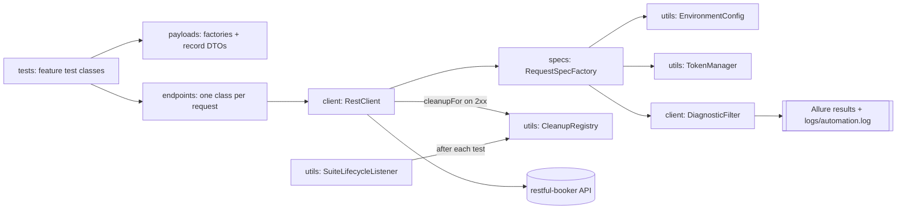

# restful-booker API Test Framework

[](https://github.com/AlhusseinZaghloul/restful-booker-api-framework/actions/workflows/api-tests.yml)

Layered Java API test automation for the public [restful-booker](https://restful-booker.herokuapp.com/apidoc/index.html) demo API, built with REST Assured, TestNG, Allure and GitHub Actions.

- **Design:** [ARCHITECTURE_BLUEPRINT.md](ARCHITECTURE_BLUEPRINT.md) (architecture, overrides, class contracts) and [TEST_CASES_MATRIX.md](TEST_CASES_MATRIX.md) (36 test cases).
- **Standards:** [docs/STANDARDS.md](docs/STANDARDS.md), with the short rule list in [docs/RULES_DIGEST.md](docs/RULES_DIGEST.md).
- **Latest report:** <https://alhusseinzaghloul.github.io/restful-booker-api-framework/> (published by CI from `main`).

## Architecture



- **One class per API request.** Mandatory inputs are constructor arguments; tests never call `given()`, write routes or set headers.
- **No `BaseTest`.** Config, auth, logging and cleanup live in framework layers and in one TestNG listener.
- **Automatic cleanup.** Every created booking is deleted after its test, pass or fail. A pre-suite sweep deletes leftovers marked `lastname = QA-AUTO`.

## Tech stack

| Area | Library | Version |
|---|---|---|
| Language | Java (Temurin) | 25 |
| Build | Maven | 3.9+ |
| HTTP client | REST Assured (+ json-schema-validator) | 6.3.0 |
| Test runner | TestNG | 7.12.0 |
| JSON | Jackson databind | 2.23.0 |
| Reporting | Allure TestNG 3.1.1, Allure report 2.46.2 | |
| Logging | SLF4J 2.0.20 + Log4j2 2.26.1 | |
| Test data | Datafaker 2.7.0, Lombok 1.18.48 | |
| CI/CD | GitHub Actions + GitHub Pages | |

## Project layout

```text
src/test/java/io/github/alhusseinzaghloul/restfulbooker/
├── tests/        auth/, booking/, health/        test classes (feature packages)
├── endpoints/    auth/, booking/, health/        one class per API request
├── payloads/     pojos/ (records), factories/    request/response DTOs and test data
├── client/       BaseApiRequest, RestClient, ApiClientFactory, DiagnosticFilter
├── specs/        RequestSpecFactory, ResponseSpecFactory
└── utils/        EnvironmentConfig, TokenManager, CleanupRegistry, SuiteLifecycleListener, ...
src/test/resources/
├── config/dev.properties    environment settings
├── schemas/                 JSON Schemas for contract tests
├── suites/                  smoke.xml, regression.xml, known-defects.xml
├── allure.properties, categories.json, log4j2-test.xml
└── META-INF/services/org.testng.ITestNGListener
```

## Prerequisites

- JDK 25 on `PATH` and `JAVA_HOME` (`mvn -v` must report Java 25)
- Maven 3.9+
- The `AUTH_PASSWORD` environment variable. The demo password is published in the [API docs](https://restful-booker.herokuapp.com/apidoc/index.html). It is never committed.

```bash
export AUTH_PASSWORD='<password from the API docs>'
```

## Running

Regression suite (the CI gate, default):

```bash
mvn clean test
```

Smoke suite:

```bash
mvn clean test -Dsuite=src/test/resources/suites/smoke.xml
```

Known-defects suite (contract tests that fail until the API is fixed; non-blocking):

```bash
mvn test -Dsuite=src/test/resources/suites/known-defects.xml
```

Open the Allure report locally:

```bash
mvn allure:serve
```

Logs go to the console and to `logs/automation.log`. Every line shows the thread and the running test.

## Configuration

Values resolve in this order: `-Dkey=value` system property → environment variable (`base.uri` → `BASE_URI`) → `src/test/resources/config/<env>.properties`. Select the environment with `-Denv=<name>` (default `dev`).

| Key | Default (`dev`) | Notes |
|---|---|---|
| `base.uri` | `https://restful-booker.herokuapp.com` | |
| `base.path` | *(empty)* | |
| `auth.type` | `cookie-token` | `none`, `cookie-token` or `bearer` |
| `auth.path` | `/auth` | |
| `auth.username` | `admin` | |
| `auth.password` | — | Env var `AUTH_PASSWORD` only |
| `sweep.enabled` | `true` | Set `-Dsweep.enabled=false` when two local runs overlap |

## CI/CD

[.github/workflows/api-tests.yml](.github/workflows/api-tests.yml) runs on pushes and pull requests to `main` and on demand:

1. Regression suite: the gate that fails the build.
2. Known-defects suite: `continue-on-error`, so it never blocks.
3. Allure report with history carried over from the previous published report.
4. Results, report and logs uploaded as a build artifact.
5. On `main` pushes, the report is deployed to [GitHub Pages](https://alhusseinzaghloul.github.io/restful-booker-api-framework/).

Repository setup: add the `AUTH_PASSWORD` secret, and set **Settings → Pages → Source** to "GitHub Actions".

## Known deviations

The API differs from REST conventions or its own docs in these places. RB-DEF-001…007 each have an actual-behavior test in the gate; the four marked "dual" also have a contract test in the known-defects suite. RB-DEF-008 is observed but not automated. Full detail: [blueprint §9](ARCHITECTURE_BLUEPRINT.md#9-known-deviations).

| ID | Endpoint | Expected | Actual | Tests |
|---|---|---|---|---|
| RB-DEF-001 | `POST /auth`, bad credentials | 401 | 200 + `reason` | TC-NEG-001 |
| RB-DEF-002 | `POST /booking`, missing field | 400 | 500 | dual: TC-NEG-002 / 003 |
| RB-DEF-003 | `POST /booking`, text `totalprice` | 400 | 200, price stored as `null` | dual: TC-NEG-004 / 005 |
| RB-DEF-004 | `PUT/PATCH/DELETE`, invalid token | 401 | 403 | dual: TC-NEG-009 / 010 |
| RB-DEF-005 | `PUT/PATCH/DELETE`, unknown id | 404 | 405 | dual: TC-NEG-007 / 008 |
| RB-DEF-006 | `GET /booking?checkin=` | `>=` (docs) | `>` | TC-BKG-010 |
| RB-DEF-007 | `GET /booking?checkout=` | `>=` (docs) | `<=` | TC-BKG-011 |
| RB-DEF-008 | Any endpoint, multi-value `Accept` header | 200 (or 406) | 418 I'm a teapot | Not automated: the framework always sends exactly `Accept: application/json` |

Documented but non-REST status codes (not defects): `POST /booking` → 200, `DELETE` → 201, `GET /ping` → 201.
