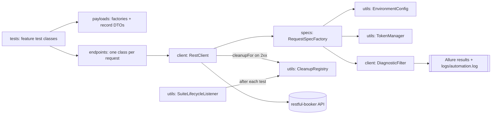

# restful-booker API Test Framework

[](https://github.com/AlhusseinZaghloul/restful-booker-api-framework/actions/workflows/api-tests.yml)

Layered Java API test automation for the public [restful-booker](https://restful-booker.herokuapp.com/apidoc/index.html) demo API, built with REST Assured, TestNG, Allure and GitHub Actions.

- **Design:** [ARCHITECTURE_BLUEPRINT.md](ARCHITECTURE_BLUEPRINT.md) (architecture, overrides, class contracts) and [TEST_CASES_MATRIX.md](TEST_CASES_MATRIX.md) (36 test cases).
- **Standards:** [docs/STANDARDS.md](docs/STANDARDS.md), with the short rule list in [docs/RULES_DIGEST.md](docs/RULES_DIGEST.md).
- **Design decisions:** [docs/DESIGN_DECISIONS.md](docs/DESIGN_DECISIONS.md) (ADRs: context, options, decision, consequences).
- **Latest report:** <https://alhusseinzaghloul.github.io/restful-booker-api-framework/> (published by CI from `main`).

## Architecture



- **One class per API request.** Mandatory inputs are constructor arguments; tests never call `given()`, write routes or set headers.
- **No `BaseTest`.** Config, auth, logging and cleanup live in framework layers and in one TestNG listener.
- **Automatic cleanup.** Every created booking is deleted after its test, pass or fail. A pre-suite sweep deletes leftovers marked `lastname = QA-AUTO`.

## Tech stack

| Area | Library | Version |
|---|---|---|
| Language | Java (Temurin) | 25 |
| Build | Maven | 3.9+ |
| HTTP client | REST Assured (+ json-schema-validator) | 6.3.0 |
| Test runner | TestNG | 7.12.0 |
| JSON | Jackson databind | 2.23.0 |
| Reporting | Allure TestNG 3.1.1, Allure report 2.46.2 | |
| Logging | SLF4J 2.0.20 + Log4j2 2.26.1 | |
| Test data | Datafaker 2.7.0, Lombok 1.18.48 | |
| CI/CD | GitHub Actions + GitHub Pages | |

## Project layout

```text
src/test/java/io/github/alhusseinzaghloul/restfulbooker/
├── tests/        auth/, booking/, health/        test classes (feature packages)
├── endpoints/    auth/, booking/, health/        one class per API request
├── payloads/     pojos/ (records), factories/    request/response DTOs and test data
├── client/       BaseApiRequest, RestClient, ApiClientFactory, DiagnosticFilter
├── specs/        RequestSpecFactory, ResponseSpecFactory
└── utils/        EnvironmentConfig, TokenManager, CleanupRegistry, SuiteLifecycleListener, ...
src/test/resources/
├── config/dev.properties    environment settings
├── schemas/                 JSON Schemas for contract tests
├── suites/                  smoke.xml, regression.xml, known-defects.xml
├── allure.properties, categories.json, log4j2-test.xml
└── META-INF/services/org.testng.ITestNGListener
```

## Prerequisites

- JDK 25 on `PATH` and `JAVA_HOME` (`mvn -v` must report Java 25)
- Maven 3.9+
- The `AUTH_PASSWORD` environment variable. The demo password is published in the [API docs](https://restful-booker.herokuapp.com/apidoc/index.html). It is never committed.

Bash (Linux, macOS, Git Bash):

```bash
export AUTH_PASSWORD='<password from the API docs>'
```

PowerShell (Windows):

```powershell
$env:AUTH_PASSWORD = '<password from the API docs>'
```

## Running

Regression suite (the CI gate, default):

```bash
mvn clean test
```

Smoke suite:

```bash
mvn clean test -Dsuite=src/test/resources/suites/smoke.xml
```

Known-defects suite (contract tests that fail until the API is fixed; non-blocking):

```bash
mvn test -Dsuite=src/test/resources/suites/known-defects.xml
```

Open the Allure report locally:

```bash
mvn allure:serve
```

Logs go to the console and to `logs/automation.log`. Every line shows the thread and the running test.

## Configuration

Values resolve in this order: `-Dkey=value` system property → environment variable (`base.uri` → `BASE_URI`) → `src/test/resources/config/<env>.properties`. Select the environment with `-Denv=<name>` (default `dev`).

| Key | Default (`dev`) | Notes |
|---|---|---|
| `base.uri` | `https://restful-booker.herokuapp.com` | |
| `base.path` | *(empty)* | |
| `auth.type` | `cookie-token` | `none`, `cookie-token` or `bearer` |
| `auth.path` | `/auth` | |
| `auth.username` | `admin` | |
| `auth.password` | — | Env var `AUTH_PASSWORD` only |
| `sweep.enabled` | `true` | Set `-Dsweep.enabled=false` when two local runs overlap |

## CI/CD

[.github/workflows/api-tests.yml](.github/workflows/api-tests.yml) runs on pushes and pull requests to `main` and on demand:

1. Regression suite: the gate that fails the build.
2. Known-defects suite: `continue-on-error`, so it never blocks.
3. Allure report with history carried over from the previous published report.
4. Results, report and logs uploaded as a build artifact.
5. On `main` pushes, the report is deployed to [GitHub Pages](https://alhusseinzaghloul.github.io/restful-booker-api-framework/).

Repository setup: add the `AUTH_PASSWORD` secret, and set **Settings → Pages → Source** to "GitHub Actions".

## Design decisions

Full records with the options considered: [docs/DESIGN_DECISIONS.md](docs/DESIGN_DECISIONS.md).

- **One class per API request** (`CreateBookingRequest`, `GetBookingIdsRequest`, …), with mandatory inputs as constructor arguments.
  *Trade-off:* more classes, but an API change touches one class and an incomplete request does not compile.
- **No `BaseTest`.** One `SuiteLifecycleListener`, registered through `ServiceLoader`, runs the health check, the sweep, per-test cleanup and report files.
  *Trade-off:* the lifecycle cannot be left out of any run, but it is not visible from the test code.
- **Automatic cleanup plus a marker sweep.** Create requests register their own delete; leftovers marked `lastname = QA-AUTO` are swept at suite start.
  *Trade-off:* tests contain no cleanup code, but the sweep also deletes the bookings of an overlapping run.
- **Dual tests for API deviations.** An actual-behavior test guards the gate; a `[KNOWN-DEFECT]` contract test runs in a non-blocking suite.
  *Trade-off:* the gate stays green and still detects changes, but a fixed API means updating two tests.
- **Configurable `auth.type`** (`none`, `cookie-token`, `bearer`), with one cached login per run in `TokenManager`.
  *Trade-off:* reusable for other APIs, but the `bearer` path has not run against a real bearer API.
- **`DiagnosticFilter` as the single telemetry source**, masking headers, cookies and secret body fields for both Allure and the log.
  *Trade-off:* every call is diagnosable from the report, but new secret field names must be added to the mask pattern.
- **Records with Lombok builders**, plus typed DTOs for wrong-type payloads and constants for malformed JSON.
  *Trade-off:* concise, immutable test data, but Lombok must be configured as an annotation processor.
- **Parallel by class** (4 threads), with per-thread cleanup queues and `Faker` instances.
  *Trade-off:* a full regression run takes about 40 seconds, but shared data in `@BeforeClass` and `@Test(timeOut)` are not allowed.

## Engineering challenges solved

**HTTP 418 on every request.**
*Symptom:* 24 of 32 tests failed because `POST /booking` returned 418 "I'm a teapot", while the same call with curl returned 200.
*Root cause:* `setAccept(ContentType.JSON)` sends four media types (`application/json, application/javascript, …`), and the API answers any multi-value `Accept` with 418. *Fix:* send exactly `Accept: application/json` (O21); recorded as RB-DEF-008.

**Surefire 3.6.1 does not run TestNG suite files.**
*Symptom:* `mvn test` failed before any test ran: "Parameter suiteXmlFiles is not supported since 3.6.0".
*Root cause:* Surefire 3.6 runs TestNG on the JUnit Platform, which cannot read TestNG suite XML. *Fix:* pin Surefire 3.5.6, the latest release that supports suite files (O25).

**405 on an already-deleted booking.**
*Symptom:* any test that deletes its own booking would leave a false "cleanup failure", because the automatic cleanup tries the delete again.
*Root cause:* the API returns 405, not 404, for an id that no longer exists, and Rule 3.19 treats only 404 as "already gone". *Fix:* a per-request `isAlreadyGone()` hook; `DeleteBookingRequest` accepts 404 and 405 (O12).

**The token cookie was outside header masking.**
*Symptom:* the Standards filter only describes headers, so the token cookie was missing from the report, and any later change that printed cookies would have leaked it.
*Root cause:* REST Assured keeps cookies separately from headers. *Fix:* `DiagnosticFilter` prints `request.getCookies()` with masked values, also in the cURL attachment (O14). Verified: every report shows `Cookie: token=***`, and the real password appears in no result or log file.

**Known defects reported as "Product defects".**
*Symptom:* the Allure report ignored the custom categories and put the four known-defect failures under its default category.
*Root cause:* writing `categories.json` through a shell heredoc turned `\\[` into `\[`, an invalid JSON escape, and Allure silently skipped the file. *Fix:* rewrote the file with exact content and validated every JSON resource with a parser.

**Date filters that contradict the docs.**
*Symptom:* filter tests built from the docs (`checkin >= date`, `checkout >= date`) would include or exclude bookings unexpectedly.
*Root cause:* the API filters `checkin > date` (strict) and `checkout <= date` (inverted), confirmed with two separate probe bookings. *Fix:* positive tests use boundary values that pass under both meanings; TC-BKG-010/011 pin the real behavior (RB-DEF-006/007).

## Limitations and next steps

- **Shared public API.** Tests run against a demo server that other people use and that is reset periodically, so latency and occasional failures are outside our control. Next: run the suites against a local restful-booker container, with WireMock for failure cases.
- **Overlapping runs.** The marker sweep deletes every `QA-AUTO` booking, so two runs from different machines can delete each other's data. CI runs are serialized; next: a per-run marker (for example the CI run id) in the lastname.
- **One environment.** Only `config/dev.properties` exists. Next: a staging config and an environment matrix in CI.
- **Thin negative coverage, by design.** There is one representative test per negative category (Rule 2.15); PATCH/DELETE permutations, XML and form-encoded bodies, and RB-DEF-008 are not automated.
- **Actual-behavior tests lock in API bugs.** When the API is fixed, the gate turns red until each actual-behavior test and its contract test are updated together.
- **Surefire is pinned to 3.5.x.** Next: move from suite XMLs to group selection or a JUnit Platform `@Suite`, so Surefire 3.6+ can be used.

## Known deviations

The API differs from REST conventions or its own docs in these places. RB-DEF-001…007 each have an actual-behavior test in the gate; the four marked "dual" also have a contract test in the known-defects suite. RB-DEF-008 is observed but not automated. Full detail: [blueprint §9](ARCHITECTURE_BLUEPRINT.md#9-known-deviations).

| ID | Endpoint | Expected | Actual | Tests |
|---|---|---|---|---|
| RB-DEF-001 | `POST /auth`, bad credentials | 401 | 200 + `reason` | TC-NEG-001 |
| RB-DEF-002 | `POST /booking`, missing field | 400 | 500 | dual: TC-NEG-002 / 003 |
| RB-DEF-003 | `POST /booking`, text `totalprice` | 400 | 200, price stored as `null` | dual: TC-NEG-004 / 005 |
| RB-DEF-004 | `PUT/PATCH/DELETE`, invalid token | 401 | 403 | dual: TC-NEG-009 / 010 |
| RB-DEF-005 | `PUT/PATCH/DELETE`, unknown id | 404 | 405 | dual: TC-NEG-007 / 008 |
| RB-DEF-006 | `GET /booking?checkin=` | `>=` (docs) | `>` | TC-BKG-010 |
| RB-DEF-007 | `GET /booking?checkout=` | `>=` (docs) | `<=` | TC-BKG-011 |
| RB-DEF-008 | Any endpoint, multi-value `Accept` header | 200 (or 406) | 418 I'm a teapot | Not automated: the framework always sends exactly `Accept: application/json` |

Documented but non-REST status codes (not defects): `POST /booking` → 200, `DELETE` → 201, `GET /ping` → 201.
